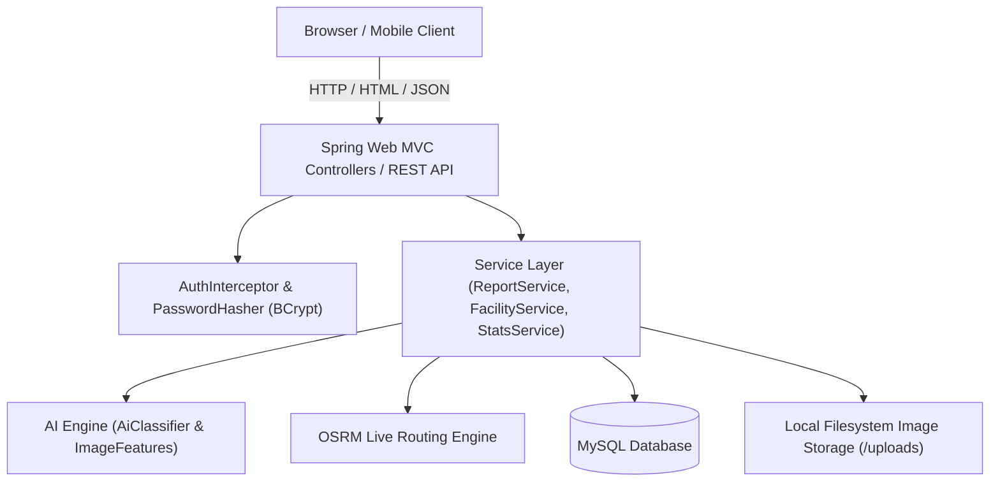

# 🌿 CleanVision (Swachh Sankalp)

> **AI-Powered Civic Incident, Municipal Waste & Animal Rescue Management Platform**

[](https://openjdk.org/)
[](https://spring.io/projects/spring-boot)
[](https://www.mysql.com/)
[](https://leafletjs.com/)
[](https://www.thymeleaf.org/)

---

## 📌 Table of Contents

- [Overview](#-overview)
- [Key Features](#-key-features)
  - [🤖 AI Visual Waste Classifier](#-ai-visual-waste-classifier)
  - [🐾 Stray & Injured Animal Rescue Module](#-stray--injured-animal-rescue-module)
  - [🗺️ Interactive GIS & Ward Analytics](#️-interactive-gis--ward-analytics)
  - [🚛 Smart Disposal Facility Routing (OSRM)](#-smart-disposal-facility-routing-osrm)
  - [👥 Role-Based Portals & Access Control](#-role-based-portals--access-control)
- [Demo Credentials](#-demo-credentials)
- [Architecture & Tech Stack](#-architecture--tech-stack)
- [Getting Started](#-getting-started)
  - [Prerequisites](#prerequisites)
  - [Environment Configuration](#environment-configuration)
  - [Running the Application](#running-the-application)
  - [Running Automated Tests](#running-automated-tests)
  - [Building the Production Package](#building-the-production-package)
- [REST API Reference](#-rest-api-reference)
- [Project Directory Structure](#-project-directory-structure)
- [Data Seeding & Mock Data](#-data-seeding--mock-data)
- [License](#-license)

---

## 🌟 Overview

**CleanVision (Swachh Sankalp)** is an enterprise-grade civic management system designed to streamline urban sanitation and animal rescue operations. It addresses the communication gap between citizens and municipal authorities by combining:

1. **Computer Vision & Heuristic AI** to instantly classify waste type, compute severity, and score confidence from uploaded photos.
2. **Citizen Reporting** with automated geolocation tagging, reverse geocoding, and duplicate tracking.
3. **Municipal Triage & Workflows** to manage incident statuses, dispatch specialized sanitation or animal welfare teams, and track resolution timelines.
4. **Before & After Cleanup Verification** to maintain transparency and civic accountability.
5. **Smart Routing** using real-world road networks (via OSRM) to direct cleanup crews to the most suitable waste recovery and disposal facilities.

---

## 🚀 Key Features

### 🤖 AI Visual Waste Classifier
- **Feature Extraction Engine**: Analyzes color spectrum ratios (RGB/HSV), edge density, colorfulness, texture entropy, and brightness levels.
- **Categorization**: Detects 8 distinct waste categories:
  - 🧴 **Plastic**
  - 🍎 **Organic / Biodegradable**
  - 📦 **Paper & Cardboard**
  - 🍾 **Glass**
  - 🥫 **Metal**
  - 🔌 **E-Waste**
  - 🧱 **Construction & Demolition (C&D)**
  - 🗑️ **Mixed Waste**
- **Priority & Confidence Scoring**: Assigns severity levels (`LOW`, `MEDIUM`, `HIGH`, `CRITICAL`) and confidence metrics to triage urgent hazards.
- **Pluggable Architecture**: Modular design allowing drop-in replacement with deep learning CNN/ONNX models without changing service or API contracts.

### 🐾 Stray & Injured Animal Rescue Module
- Dedicated incident pipeline for stray and domestic animal distress calls.
- Classifies animals (Dog, Cat, Cattle, Bird, Wildlife) and conditions (Injured, Sick, Trapped, Aggressive, Abandoned).
- Dispatches dedicated **Animal Rescue Units** equipped for veterinary triage rather than standard waste crews.

### 🗺️ Interactive GIS & Ward Analytics
- **Live Incident Mapping**: Powered by Leaflet.js with custom color-coded status and category markers.
- **Ward-Level Heatmaps**: Visualizes density of open dumps, response latencies, and resolution efficiency across municipal wards.
- **GPS Coordinates**: Embedded latitude and longitude for pinpoint field navigation.

### 🚛 Smart Disposal Facility Routing (OSRM)
- Integrates with the **Project-OSRM Driving Table API** to compute live road network distances and travel durations.
- Automatically matches waste category compatibility with authorized facility types:
  - Material Recovery Facilities (MRF)
  - Composting & Biogas Plants
  - Recycling Centres
  - E-Waste Depots
  - C&D Processing Plants
  - Transfer Stations & Engineered Landfills
- Provides one-click navigation links to Google Maps for sanitation vehicle drivers.

### 👥 Role-Based Portals & Access Control

| Role | Landing Path | Core Permissions |
| :--- | :--- | :--- |
| **Citizen** | `/my-reports` | File waste & animal reports, photo upload, live GPS detection, personal incident tracking. |
| **Municipal Officer (Admin)** | `/admin` | Municipal dashboard, report triage, assigning teams, status workflow updates, facility management. |
| **Team Leader (Field Crew)** | `/team` | Field dashboard, active assignment list, status updates, after-cleanup photo evidence, OSRM disposal routing. |
| **Super Admin** | `/admin/users` | System user administration, role provisioning, officer & team lead management. |

---

## 🔐 Demo Credentials

When running with default seed data enabled (`DataSeeder`), the following accounts are pre-populated:

| Role | Email | Password | Primary Purpose |
| :--- | :--- | :--- | :--- |
| **Super Admin** | `super@cleanvision.gov.in` | `super123` | System administration & user provisioning |
| **Municipal Officer** | `admin@cleanvision.gov.in` | `admin123` | Master dashboard, report assignment & management |
| **Team Leader** | `leader@cleanvision.gov.in` | `leader123` | Field team dispatch, cleanup updates & disposal |
| **Citizen** | `citizen@demo.in` | `demo123` | Sample citizen account with existing reports |

---

## 🏗️ Architecture & Tech Stack



- **Backend**: Java 17, Spring Boot 4.1.1 (Spring Web MVC, Spring Data JPA, Spring Security Crypto, Spring Actuator, Lombok)
- **Frontend**: Thymeleaf, Vanilla CSS Design System, Bootstrap Icons, Leaflet.js
- **Database**: MySQL 8.x (production & development), H2 In-Memory (test suite)
- **Routing**: Project-OSRM Driving Table API & OpenStreetMap Tiles
- **Build Tool**: Apache Maven (via `./mvnw`)

---

## ⚙️ Getting Started

### Prerequisites
- **Java Development Kit (JDK)**: Version 17 or higher
- **MySQL Server**: Version 8.0 or higher running locally (or Docker container)
- **Git**: For version control

---

### Environment Configuration

The application reads configuration from environment variables, falling back to sane local defaults in `src/main/resources/application.properties`.

You can configure an optional `.env` file at the root of the project:

```bash
# --- Database Configuration ---
DB_URL="jdbc:mysql://localhost:3306/cleanvision?createDatabaseIfNotExist=true&useSSL=false&allowPublicKeyRetrieval=true&serverTimezone=UTC"
DB_USERNAME="root"
DB_PASSWORD="your_password"

# --- HTTP Server ---
SERVER_PORT="8080"

# --- Uploads Directory ---
CLEANVISION_UPLOAD_DIR="./uploads"
```

---

### Running the Application

1. **Clone the repository**:
   ```bash
   git clone https://github.com/Gaurav-gupta01/cleanVision.git
   cd cleanVision
   ```

2. **Load environment variables (macOS / Linux)**:
   ```bash
   set -a; source .env; set +a
   ```

3. **Start the Spring Boot application**:
   ```bash
   ./mvnw spring-boot:run
   ```
   *(On Windows Command Prompt, use `mvnw.cmd spring-boot:run`)*

4. **Access the application**:
   - Open your browser at: **`http://localhost:8080`**
   - The application will automatically create database schemas and seed initial mock reports, facilities, teams, and user accounts.

---

### Running Automated Tests

The test suite runs against an isolated in-memory **H2 database** with MySQL compatibility mode enabled. Running tests will never overwrite or touch your local MySQL data:

```bash
./mvnw test
```

---

### Building the Production Package

To create an executable JAR artifact:

```bash
./mvnw clean package -DskipTests
```

The resulting JAR will be generated in `target/demo-0.0.1-SNAPSHOT.jar`. Run it with:

```bash
java -jar target/demo-0.0.1-SNAPSHOT.jar
```

---

## 📡 REST API Reference

CleanVision includes a JSON REST API under `/api` for integrations:

| Method | Endpoint | Description | Auth Required |
| :--- | :--- | :--- | :--- |
| `POST` | `/api/auth/register` | Register a new citizen account | No |
| `POST` | `/api/auth/login` | Authenticate and obtain session | No |
| `POST` | `/api/ai/classify` | Upload multipart image and get AI waste category & confidence | Citizen |
| `POST` | `/api/reports` | Create a new waste incident report | Citizen |
| `GET` | `/api/reports` | List reports (filtered by user role) | Citizen / Officer |
| `GET` | `/api/reports/{id}` | Retrieve report details, status history & assignment | Citizen / Officer |
| `PUT` | `/api/reports/{id}/status` | Update incident status (`ASSIGNED`, `IN_PROGRESS`, `RESOLVED`, etc.) | Officer |
| `GET` | `/api/dashboard/statistics`| Get aggregated municipal waste metrics | No |

---

## 📂 Project Directory Structure

```text
swachSankalp/
├── .env                                # Local environment variables (ignored by git)
├── pom.xml                             # Maven build dependencies & plugin configurations
├── uploads/                            # Stored incident photographs (before & after)
├── src/
│   ├── main/
│   │   ├── java/CleanVision/
│   │   │   ├── Application.java        # Spring Boot application entry point
│   │   │   ├── ai/                     # AI classification engine & image feature extraction
│   │   │   │   ├── AiClassifier.java
│   │   │   │   ├── AiResult.java
│   │   │   │   └── ImageFeatures.java
│   │   │   ├── config/                 # Seeders & WebMvc configuration
│   │   │   │   ├── DataSeeder.java
│   │   │   │   ├── FacilitySeeder.java
│   │   │   │   └── WebConfig.java
│   │   │   ├── domain/                 # JPA Entities and Enums (Report, Team, Facility, User)
│   │   │   ├── dto/                    # Web & API Request/Response forms
│   │   │   ├── repository/             # Spring Data JPA repositories
│   │   │   ├── security/               # Session interceptor & BCrypt password hasher
│   │   │   ├── service/                # Business logic (ReportService, FacilityService, Stats)
│   │   │   └── web/                    # Spring MVC & REST Controllers
│   │   └── resources/
│   │       ├── application.properties  # Default application configuration
│   │       ├── static/                 # Static assets (CSS, JS, images, icons)
│   │       └── templates/              # Thymeleaf HTML views
│   │           ├── admin/              # Municipal & super admin dashboards
│   │           ├── fragments/          # Reusable layout, navigation & flash messages
│   │           ├── report/             # Citizen report creation & detail views
│   │           └── team/               # Field crew execution & disposal routing views
│   └── test/                           # Automated integration and unit tests (H2 database)
```

---

## 🔄 Incident Lifecycle Workflow

```text
[ Citizen Spots Incident ]
            │
            ▼
     [ SUBMITTED ]  ──( AI Image Analysis )──►  [ AI_ANALYZED ]
                                                      │
                                                      ▼
[ REJECTED ] ◄────( Invalid / Out of Scope )─── [ ASSIGNED ] (Dispatched to Team)
                                                      │
                                                      ▼
                                                [ IN_PROGRESS ] (Field crew on site)
                                                      │
                                                      ▼
                                                [ RESOLVED ] (After photo uploaded)
                                                      │
                                                      ▼
                                                [ CLOSED ] (Verified by Officer)
```

---

## 📦 Data Seeding & Mock Data

Upon first startup with an empty database:
- **`DataSeeder`**: Seeds standard municipal wards (Ward 1 to 5), 4 cleanup teams (including an Animal Rescue Unit), sample citizen & officer accounts, and 10 realistic incident reports in various workflow states with generated photographs.
- **`FacilitySeeder`**: Seeds 8 authorized disposal facilities (MRF, composting plants, recycling yards, e-waste centers, C&D plants, landfills) with real geo-coordinates around Margao for live OSRM routing calculations.

---

## 📄 License

This project is licensed under the [MIT License](LICENSE).
